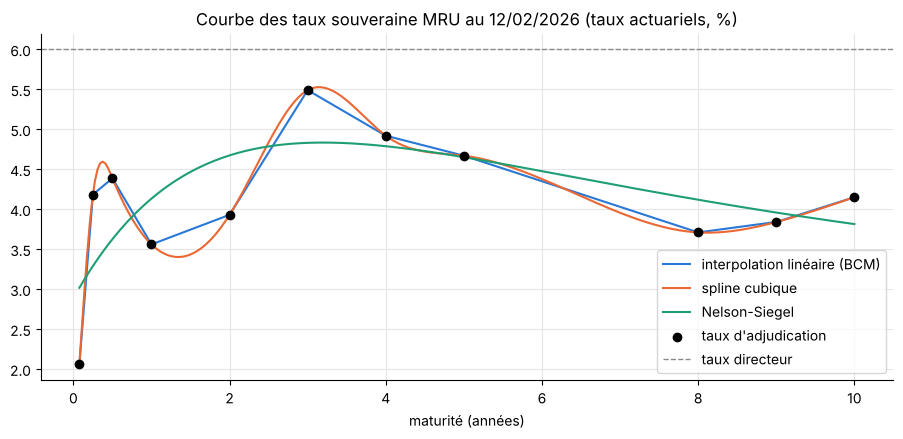
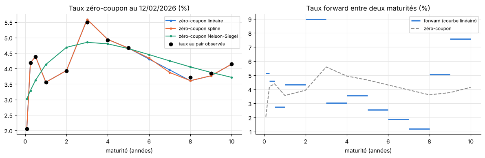
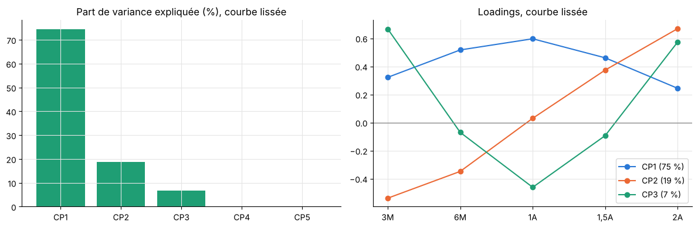
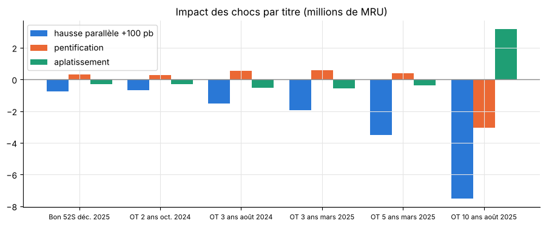
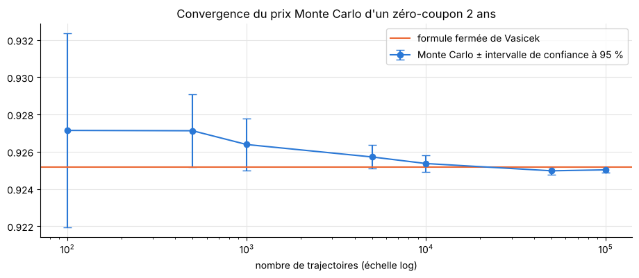

# Sovereign Yield Curve Construction & Modelling : la courbe des taux souveraine en Mauritanie (MRU)

Construction et modélisation en Python de la courbe des taux de l'État mauritanien à partir des taux d'adjudication publiés par la Banque Centrale de Mauritanie (BCM), de 2022 à 2026 : interpolation linéaire, spline cubique et Nelson-Siegel, taux zéro-coupon et forwards, analyse en composantes principales, valorisation et risque de taux d'un portefeuille de titres publics, modèle de Vasicek, simulation Monte Carlo et VaR.

**Auteur :** Abdel Kader Elhassen

## Lire le projet

| Format | Fichier |
|---|---|
| Notebook exécuté (code, graphiques, commentaires) | [`courbe_taux_MRU_modelisation.ipynb`](courbe_taux_MRU_modelisation.ipynb) |
| Version PDF | [`courbe_taux_MRU_modelisation.pdf`](courbe_taux_MRU_modelisation.pdf) |
| Version HTML (à télécharger puis ouvrir dans un navigateur) | [`courbe_taux_MRU_modelisation.html`](courbe_taux_MRU_modelisation.html) |

## Données

Source : Banque Centrale de Mauritanie (BCM), statistiques du marché monétaire ([bcm.mr](https://bcm.mr)). Fichier [`data/Marche_Monetaire.xlsx`](data), onglet « Marché monétaire » : 196 relevés hebdomadaires du 06/01/2022 au 12/02/2026 avec le taux directeur, les facilités de dépôt et de prêt, et les taux d'adjudication de 11 maturités de titres du Trésor (bons à 4, 13, 26 et 52 semaines ; obligations à 2, 3, 4, 5, 8, 9 et 10 ans).

Points d'attention, traités dans le notebook : les maturités apparaissent progressivement (courbe complète à 11 points sur 25 semaines seulement), les taux sont reportés d'une semaine à l'autre jusqu'à la prochaine adjudication, et le calendrier a quelques trous. Aucune valeur n'est complétée ni supprimée.

## Méthode

1. **Préparation :** contrôle qualité, conversion des taux simples des bons en taux actuariels pour avoir une seule convention.
2. **Construction de la courbe :** interpolation linéaire (méthode de la BCM), spline cubique et Nelson-Siegel calibré chaque semaine (grille sur λ, moindres carrés sur les β) ; comparaison par validation croisée « leave-one-out », stabilité des paramètres (λ libre ou fixé) ; bootstrapping des taux zéro-coupon, facteurs d'actualisation et forwards.
3. **Dynamique :** ACP sur les variations hebdomadaires des bons, puis sur la courbe lissée par Nelson-Siegel ; facteurs niveau, pente et courbure.
4. **Valorisation et risque :** portefeuille de 6 titres réellement adjugés (nominal hypothétique), prix, taux actuariel, duration, convexité, DV01, key rate durations ; chocs parallèle +100 pb, pentification et aplatissement.
5. **Vasicek et Monte Carlo :** calibration sur le taux à 4 semaines (régression AR(1)), simulation exacte des trajectoires, validation du prix d'un zéro-coupon contre la formule fermée avec analyse de convergence, VaR et Expected Shortfall à 95 % et 99 % sur 10 jours.
6. **Limites :** fiabilité d'une courbe construite à partir des adjudications, faute de marché secondaire liquide.

## Principaux résultats

- **Courbe au 12/02/2026 très irrégulière** : 2,1 % à 4 semaines, creux à 3,6 % à 1 an, pic à 5,5 % à 3 ans, 3,7-4,2 % à 8-10 ans, tous les titres sous le taux directeur (6 %).
- **L'interpolation linéaire prédit le mieux** un taux retiré (82 pb d'erreur, contre 89 pb pour Nelson-Siegel et 121 pb pour la spline, qui oscille entre les points). Les paramètres de Nelson-Siegel ne deviennent stables qu'après l'arrivée des maturités longues en 2025.
- **Pas de facteur commun dans les données brutes** : les variations hebdomadaires des bons sont presque indépendantes, car les maturités ne sont pas adjugées les mêmes semaines. Sur la courbe lissée, on retrouve niveau (75 %), pente (19 %) et courbure (7 %).
- **Portefeuille** (600 M MRU de nominal) : valeur 619 M MRU, duration modifiée 2,65, DV01 d'environ 164 000 MRU par point de base ; un choc de +100 pb coûte 2,6 %, bien approché par duration et convexité.
- **Vasicek** : κ = 1,32, θ = 4,9 %, σ = 3,3 % (retour à la moyenne non significatif statistiquement) ; le prix Monte Carlo converge vers la formule fermée ; VaR 10 jours à 99 % entre 5,9 et 24,9 M MRU selon la transmission du choc aux taux longs.











## Reproduire l'analyse

```bash
pip install -r requirements.txt
jupyter notebook courbe_taux_MRU_modelisation.ipynb
```

## Sources

- Banque Centrale de Mauritanie (BCM), statistiques du marché monétaire : taux directeur, facilités permanentes et résultats des adjudications de bons et d'obligations du Trésor. [bcm.mr](https://bcm.mr)
- Nelson, C. R. et Siegel, A. F. (1987), *Parsimonious Modeling of Yield Curves*, Journal of Business, 60(4).
- Diebold, F. X. et Li, C. (2006), *Forecasting the Term Structure of Government Bond Yields*, Journal of Econometrics, 130(2).
- Vasicek, O. (1977), *An Equilibrium Characterization of the Term Structure*, Journal of Financial Economics, 5(2).

## Limites

Taux issus des adjudications (marché primaire) et non d'un marché secondaire : points non synchronisés, bruit propre à chaque séance, maturités 6 et 7 ans absentes. Portefeuille et nominal hypothétiques. Vasicek à un facteur calibré sur l'historique (pas sur les prix de marché), avec des taux négatifs possibles.
